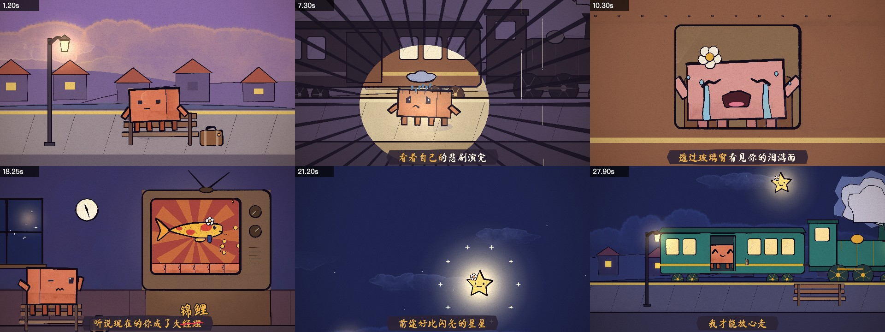
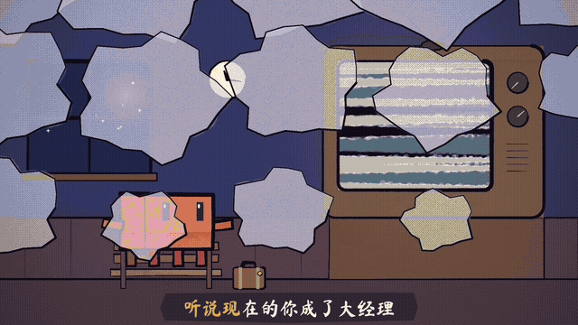

<div align="center">

# painted-animation

<a href="README.md"></a>
<a href="README.zh-CN.md"></a>

A standalone skill for producing hand-painted watercolor shorts and pixel-style lyric MVs (MP4) with any coding agent that can load a `SKILL.md`.

</div>



## Overview

This skill walks an agent through a complete animated video: storyboard, character animation, camera, transitions, music sync, and karaoke subtitles. Imagery is drawn procedurally in code with [p5.js](https://p5js.org); frames are rendered in headless Chrome and encoded with ffmpeg. **No image-generation model is required.**

There are two looks, one renderer:

- **Hand-painted watercolor / ink** — p5.js plus the [p5.brush](https://github.com/acamposuribe/p5.brush) watercolor library.
- **Pixel-style lyric MV** (JRPG, arcade, platformer, chunky indie pixel) — a small logical grid, nearest-neighbor blit to 1920×1080, plus a crisp overlay for HUD and lyrics.

The method is derived from two projects by John Heibel: [PDoomVideo](https://github.com/JohnHeibel/PDoomVideo), a 156-second music video produced largely autonomously, and [ClaudeAnimationBase](https://github.com/JohnHeibel/ClaudeAnimationBase), a general-purpose animation kit based on it. This package is a **standalone fork/extension** of the skill originally published as `painted-animation` in [opus-video-skills](https://github.com/tuzhechen2005/opus-video-skills) (a copy also circulated as [claude-mv-skill](https://github.com/Joker-chichi/claude-mv-skill)). It keeps the watercolor pipeline and adds a pixel lyric-MV path, a hard lyric→storyboard gate, and CJK-safe typography / on-screen language rules learned in production.

It works with coding agents that can load a `SKILL.md` — including Claude Code, Grok Bot / Cursor skills, and similar setups. It does **not** require a particular model.

## How It Works

1. **Intake.** For a music video, the agent first requests the audio and LRC lyrics, then asks one optional natural-language question about the desired story and overall feeling, recurring imagery, and anything to avoid. The user may answer in one sentence or leave it blank.
2. **Lyric→storyboard hard gate (lyric MVs).** The agent writes a full `STORYBOARD.md` (one row per LRC line: setting, event, camera, transition, reads) and waits for confirmation before any scene code or full render. Non-lyric shorts still get a storyboard first; the hard gate is strictest for lyric MVs.
3. **Drawing.** Each shot is a JavaScript function of time `t`. Watercolor shots paint with p5.brush; pixel shots draw on the logical grid and blit up with nearest-neighbor scaling.
4. **Review.** Small contact sheets, frame strips, and close-up crops are rendered and inspected until each shot meets the guidelines.
5. **Output.** The agent never starts a complete render without asking whether to render **locally or in the cloud**. Choosing local prohibits a cloud full render and produces exact local commands instead. Frames are rendered in parallel and encoded to MP4 with ffmpeg, with audio muxed in if provided.

## Characteristics

- **Character consistency.** Each character is defined by a single drawing function, so its design is identical across all shots.
- **Frame-accurate timing.** Because frames are computed from time, events can be aligned precisely to beats or to individual sung syllables.
- **Localised revision.** A change to one element requires editing only the relevant code and re-rendering the affected range; the rest of the video is unaffected.
- **Built-in animation principles.** The engine provides anticipation, squash and stretch, follow-through and acted expression changes as reusable functions.
- **Automated self-review.** Rendered frames are checked against an explicit list covering legibility, timing, contacts, transitions and colour.
- **Pixel path.** Logical-grid drawing, tiled sets, pixel-native transitions, and a single lyric dialect (`rpgBox` or `ktvCaption`) on a crisp 1920×1080 overlay.
- **CJK-safe typography.** Overlay type uses a CJK-capable gothic (for example Noto Sans CJK SC). On-screen HUD, signs, title and end cards match the song's (or the user's) language; the lyric box stays readable and clear of the action, and is hidden when no line is active.

## Example: 陶喆《小镇姑娘》 (David Tao)

<p align="center"></p>

A 31-second lyric video for one verse of the song. Inputs: the lyrics, a request to take the song's wider context into account, a request to include the fan wordplay in which "大经理" (big manager) is heard as "大锦鲤" (big lucky koi), the audio file, and LRC timestamps.

- **Setting.** One small-town railway station throughout, with the ending mirroring the opening: her departure by train one year earlier, and his own departure at the end.
- **Visual motif.** A flower identifies the female character in each of her forms: at the train window, on the television, as a koi, and as a star.
- **Timing.** The song measures 154 BPM with 8 beats per line, and all action is cut to that grid.
- **Wordplay.** On the syllables "经理", the television image transforms into a koi while the subtitle is struck through and replaced with "锦鲤". The koi then leaves the screen and becomes the "shining star" of the following line.

The storyboard and scene code are available in [examples/xiaozhen](examples/xiaozhen/). **The audio is omitted for copyright reasons.**

## Requirements

- Node.js, Google Chrome, ffmpeg
- Python 3 with numpy (for tempo detection only)
- A coding agent that can load a `SKILL.md`

## Installation

This is a standalone GitHub repository. Clone it, then register the folder as a skill for your agent.

```bash
git clone https://github.com/ryan123-hub/ai-.git
```

**Claude Code.** Copy or symlink the folder to `~/.claude/skills/painted-animation` (or the project's `.claude/skills/`), then invoke `/painted-animation` or just ask for an animation or lyric MV.

**Cursor / Grok Bot and similar.** Add the folder as a skill. `SKILL.md` lives at the repo root, alongside `references/`, `template/`, `scripts/`, `examples/`, and `docs/`.

After install, agents scaffold a new project with:

```bash
bash <skill-dir>/scripts/new_project.sh <project-dir>
```

## Usage

Describe the desired video, for example:

> Make a 15-second watercolor short of Clawd trying to catch a butterfly.

> Make a lyric video for this song. (attach the audio file, the LRC file, and a short description of the story and mood)

> Make a pixel / JRPG / arcade lyric MV for this song. (audio + LRC; optional notes on the metaphor — rainy city, co-op cabinet, status-screen emotions, and so on)

The skill can also be invoked directly with `/painted-animation` where the host supports slash commands. It creates a project, presents a storyboard (and, for lyric MVs, waits for confirmation), builds and reviews each shot, and asks whether the full final render should run locally or in the cloud. Render times depend on the GPU; watercolor fills are considerably slower on integrated graphics. The pixel path is usually cheaper (one small buffer plus tiles).

## Repository Structure

| Path | Description |
|---|---|
| `SKILL.md` | Workflow and rules followed by the agent |
| `template/` | Animation engine: character, brushes, camera, transitions, karaoke, pixel grid, renderer |
| `scripts/new_project.sh` | Project scaffolding and toolchain check |
| `scripts/beat_grid.py` | Tempo and beat-phase detection with LRC line alignment |
| `references/music-video.md` | Guidelines for music videos and longer productions |
| `references/pixel-lyric-mv.md` | Pixel lyric-MV path, CJK typography, on-screen language, lyric–picture match |
| `references/lyric-storyboard.md` | Hard gate: lyric→scene storyboard before any drawing |
| `examples/xiaozhen/` | Storyboard and scene code for the example above (audio omitted) |
| `docs/` | Example stills and the koi-gag clip |
| `LICENSE` | MIT license (engine + skill documentation / extensions) |

## Acknowledgements

The animation engine and guide are adapted from [ClaudeAnimationBase](https://github.com/JohnHeibel/ClaudeAnimationBase) by John Heibel (MIT License; see [template/LICENSE](template/LICENSE)). The overall method follows his [PDoomVideo](https://github.com/JohnHeibel/PDoomVideo). This project uses p5.js, p5.brush, Puppeteer and ffmpeg.

This standalone package extends the original `painted-animation` skill with a pixel lyric-MV path and a lyric→storyboard gate, plus CJK typography and on-screen language rules. It does not claim authorship of the engine.

## License

MIT. See [LICENSE](./LICENSE). The engine under `template/` retains John Heibel's copyright as in [template/LICENSE](template/LICENSE).
