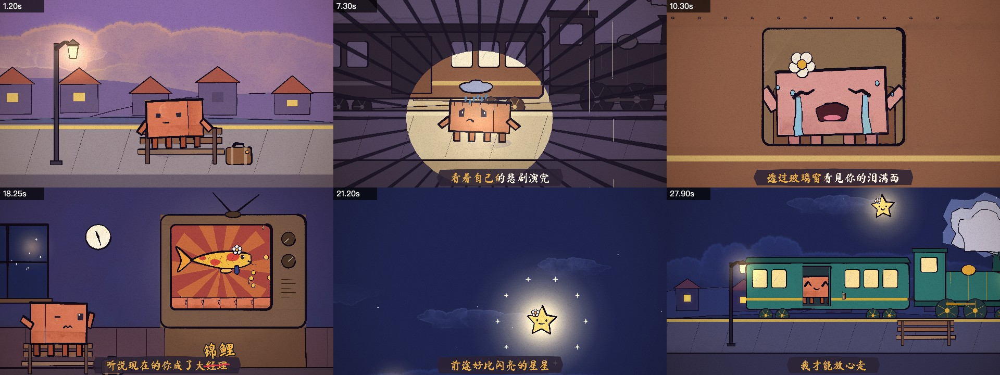
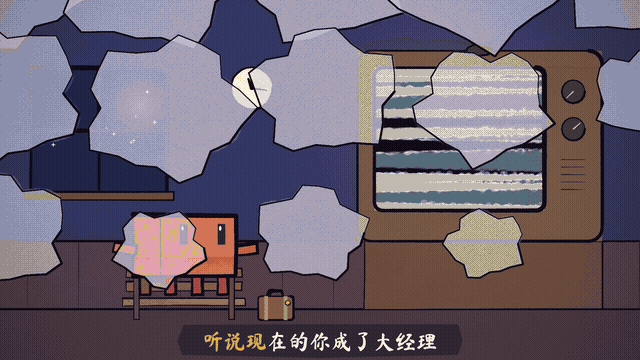

<div align="center">

# painted-animation

<a href="README.md"></a>
<a href="README.zh-CN.md"></a>

独立技能：用手绘水彩短片与像素风歌词 MV（MP4），适用于任何能加载 `SKILL.md` 的编程助手。

</div>



## 概述

本技能引导助手完成动画视频的制作，涵盖分镜、角色动画、镜头、转场、音乐同步与卡拉 OK 字幕。全部画面由代码在 [p5.js](https://p5js.org) 中程序化绘制，再用无头 Chrome 逐帧渲染、ffmpeg 编码。**不依赖任何图像生成模型。**

两种外观，同一套渲染器：

- **手绘水彩 / 墨线** — p5.js 与水彩笔刷库 [p5.brush](https://github.com/acamposuribe/p5.brush)。
- **像素风歌词 MV**（JRPG、街机、平台动作、块面独立像素）— 在小逻辑网格上作画，nearest-neighbor 放大到 1920×1080，HUD 与歌词画在清晰的叠加层上。

该方法源自 John Heibel 的两个项目：[PDoomVideo](https://github.com/JohnHeibel/PDoomVideo)（一部约 156 秒、大部分自主完成的音乐视频）和 [ClaudeAnimationBase](https://github.com/JohnHeibel/ClaudeAnimationBase)（在其基础上整理的通用动画工具包）。本仓库是原 `painted-animation` 技能的**独立分支 / 扩展**；原技能收录于 [opus-video-skills](https://github.com/tuzhechen2005/opus-video-skills)，亦有一份以 [claude-mv-skill](https://github.com/Joker-chichi/claude-mv-skill) 流传。本包保留水彩流程，并增加像素歌词 MV 路径、「歌词→场景」分镜硬门禁，以及在制作中沉淀的 CJK 字体与屏上语言文字规则。

只要编程助手能加载 `SKILL.md` 即可使用，包括 Claude Code、Grok Bot / Cursor skills 等，**不限定特定模型**。

## 技术原理

1. **素材收集。** 制作音乐 MV 时，助手会先索取歌曲音频和 LRC 歌词，再用一个可留空的自然问题，一次性询问希望呈现的故事与整体感觉、想贯穿的画面，以及需要避开的内容。用户只需回答一句话，也可以留空。
2. **歌词→场景分镜硬门禁（歌词 MV）。** 助手先写完整的 `STORYBOARD.md`（LRC 逐句：地点、事件、镜头、转场、读点），确认后再写场景代码或全片渲染。非歌词短片同样先交分镜；歌词 MV 的门禁更严格。
3. **绘制。** 每个镜头是时间 `t` 的 JavaScript 纯函数。水彩镜头用 p5.brush 绘制；像素镜头在逻辑网格上作画，再 nearest-neighbor 放大。
4. **审查。** 渲染少量关键帧拼图、短逐帧序列与局部特写，对照规范修改，直至每个镜头过关。
5. **输出。** 助手禁止未经询问直接开始完整渲染，必须让用户明确选择**本地或云端**。选择本地后禁止云端全量渲染，并改为提供准确的本地执行命令。各帧并行渲染后由 ffmpeg 编码为 MP4；如提供音频，一并合入。

## 主要特性

- **角色一致性。** 每个角色由单一绘制函数定义，在所有镜头中造型保持一致。
- **逐帧精确的时间控制。** 画面由时间计算得出，事件可精确对齐到节拍乃至单个唱词。
- **局部修改。** 修改某一元素只需调整相应代码并重新渲染受影响的片段，其余部分不受影响。
- **内置动画原理。** 引擎以可复用函数的形式提供预备动作、挤压与拉伸、跟随动作及表情过渡。
- **自动审查。** 渲染画面会依据明确的检查清单逐项核对，涵盖可读性、节奏、接触关系、转场与色彩。
- **像素路径。** 逻辑网格作画、可复用瓦片场景、像素转场，以及单一歌词方言（`rpgBox` 或 `ktvCaption`）画在 1920×1080 叠加层上。
- **CJK 友好排版。** 叠加层使用支持中日韩的黑体（如 Noto Sans CJK SC）。HUD、招牌、标题卡与结束卡须与歌曲（或用户指定）语言一致；歌词框清晰可读、不挡住角色，无唱词时不显示空框。

## 示例：陶喆《小镇姑娘》

<p align="center"></p>

本例为该曲一段主歌的 31 秒歌词 MV。输入包括：歌词；参考整首歌上下文的要求；体现歌迷将「大经理」谐音为「大锦鲤」这一梗的要求；原曲音频；LRC 时间轴。

- **场景。** 全片设定在同一座小镇火车站，首尾呼应：开头为一年前女主角乘火车离开，结尾为男主角登上火车离去。
- **视觉线索。** 女主角头上的小花贯穿她的各个形态：车窗中、电视里、锦鲤与星星。
- **节奏。** 经测定，歌曲速度为 154 BPM，每句 8 拍，全部动作均按此节拍剪辑。
- **谐音梗。** 唱到「经理」时，电视画面中的人物变为锦鲤，字幕中的「经理」同时被划去并替换为「锦鲤」；随后锦鲤跃出屏幕，化作下一句中「闪亮的星星」。

分镜与场景代码见 [examples/xiaozhen](examples/xiaozhen/)。**因版权原因，仓库中不包含音频。**

## 环境要求

- Node.js、Google Chrome、ffmpeg
- Python 3 及 numpy（仅节拍检测需要）
- 能加载 `SKILL.md` 的编程助手

## 安装

本仓库可独立上传到 GitHub。克隆后，把文件夹注册为助手的技能即可。

```bash
git clone https://github.com/ryan123-hub/ai-.git
```

**Claude Code。** 将文件夹复制或符号链接到 `~/.claude/skills/painted-animation`（或项目内的 `.claude/skills/`），然后使用 `/painted-animation`，或直接提出动画 / 歌词 MV 需求。

**Cursor / Grok Bot 等。** 将该文件夹添加为技能。`SKILL.md` 位于仓库根目录，旁边是 `references/`、`template/`、`scripts/`、`examples/` 与 `docs/`。

安装后，助手用下面的命令初始化新项目：

```bash
bash <skill-dir>/scripts/new_project.sh <project-dir>
```

## 使用方法

描述所需视频，例如：

> 制作一段 15 秒的水彩短片：Clawd 试图抓住一只蝴蝶。

> 为这首歌制作歌词 MV。（附音频文件、LRC 文件，并说明歌曲的大致故事和意境）

> 为这首歌制作像素 / JRPG / 街机风格歌词 MV。（附音频与 LRC；可选说明隐喻，例如下雨城市、双人街机、用状态界面演情绪等）

若宿主支持斜杠命令，也可通过 `/painted-animation` 直接调用。技能会创建项目、提交分镜（歌词 MV 会先等待确认）、逐个镜头制作并审查，并在完整渲染前询问应在本地还是云端执行。渲染耗时取决于显卡性能；在集成显卡上，水彩填充会明显变慢。像素路径通常更便宜（一块小缓冲加上瓦片）。

## 目录结构

| 路径 | 说明 |
|---|---|
| `SKILL.md` | 助手遵循的工作流程与规则 |
| `template/` | 动画引擎：角色、笔刷、镜头、转场、卡拉 OK、像素网格、渲染器 |
| `scripts/new_project.sh` | 项目初始化与环境检查 |
| `scripts/beat_grid.py` | 节拍与相位检测，并将 LRC 歌词对齐到节拍 |
| `references/music-video.md` | 音乐视频与长篇制作规范 |
| `references/pixel-lyric-mv.md` | 像素歌词 MV 路径、CJK 排版、屏上语言、词画对齐 |
| `references/lyric-storyboard.md` | 硬门禁：先写「歌词→场景」分镜再画 |
| `examples/xiaozhen/` | 上述示例的分镜与场景代码（不含音频） |
| `docs/` | 示例静帧与锦鲤梗短片 |
| `LICENSE` | MIT 许可（引擎 + 技能文档 / 扩展） |

## 致谢

动画引擎与动画指南改编自 John Heibel 的 [ClaudeAnimationBase](https://github.com/JohnHeibel/ClaudeAnimationBase)（MIT 协议，见 [template/LICENSE](template/LICENSE)），整体方法参照其 [PDoomVideo](https://github.com/JohnHeibel/PDoomVideo)。本项目使用了 p5.js、p5.brush、Puppeteer 与 ffmpeg。

本独立包装在原 `painted-animation` 技能之上，增加了像素歌词 MV 路径与「歌词→场景」分镜门禁，以及 CJK 字体与屏上语言文字规则。引擎的作者仍是 John Heibel，本包不声称对其拥有著作权。

## 许可协议

MIT，见 [LICENSE](./LICENSE)。`template/` 下的引擎保留 John Heibel 的版权，见 [template/LICENSE](template/LICENSE)。
